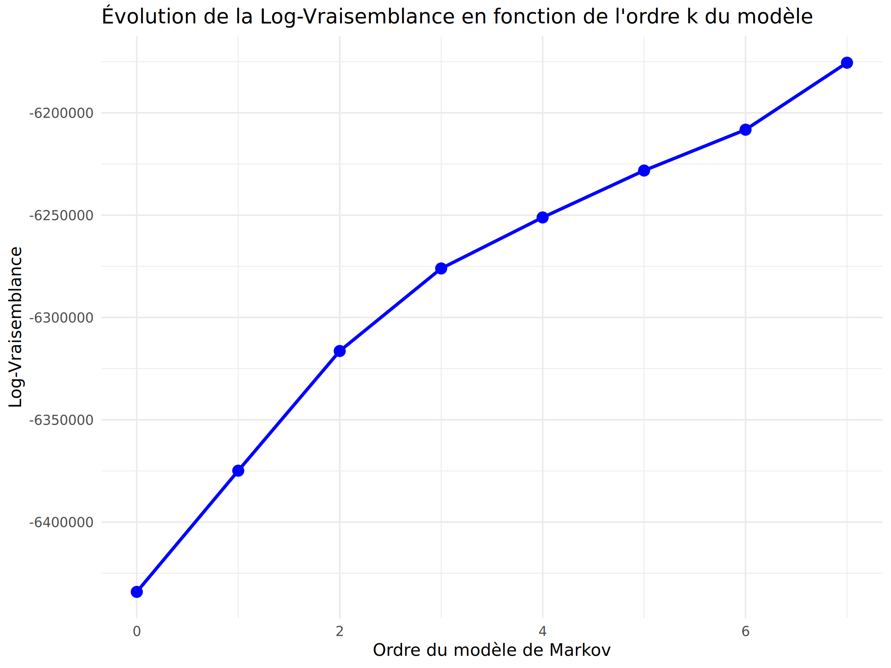
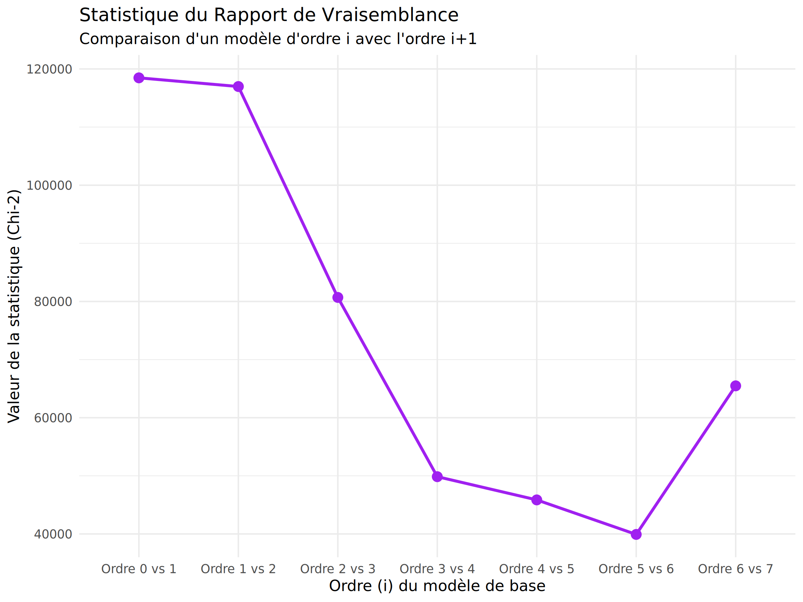
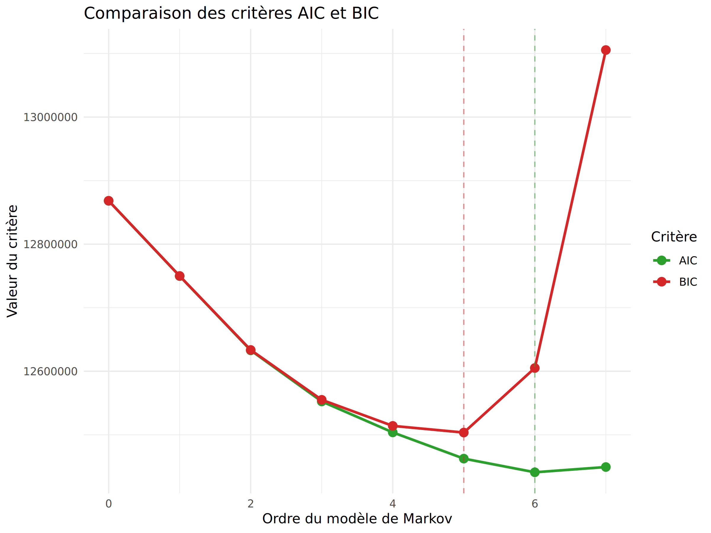
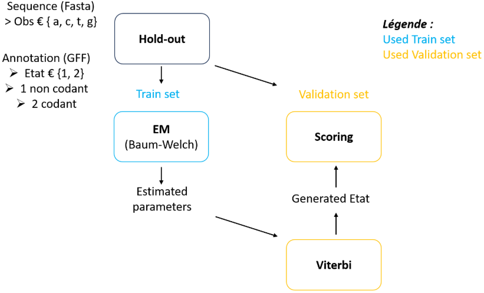
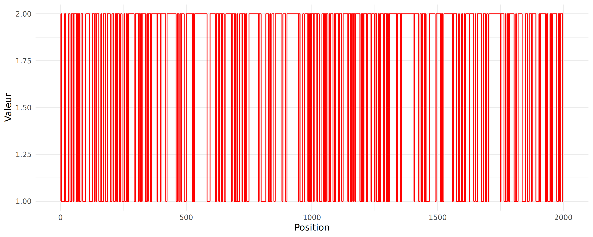
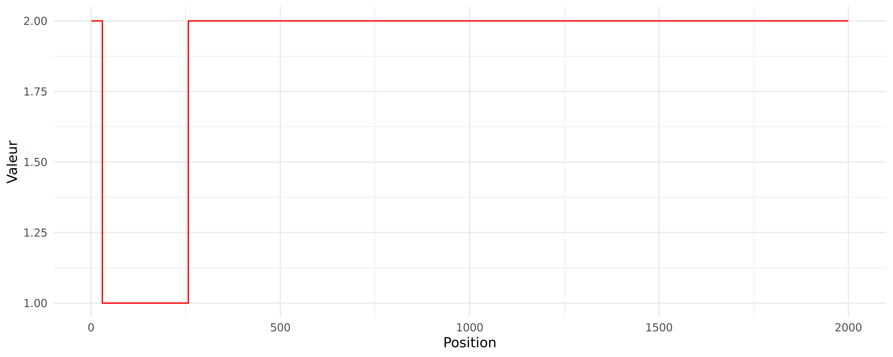

# Projet : Modèles de Markov et de Markov caché et applications pour la prédiction de gènes

**Modèle d’étude :** Nous avons décidé de nous intéresser au génome d’*Escherichia coli,* bactérie à Gram négatif largement utilisée en biologie en tant qu’organisme modèle. La séquence a été récupérée sur le site du NCBI (Fasta, GFF) à partir du lien suivant [ici](https://www.ncbi.nlm.nih.gov/datasets/genome/GCF_000005845.2/).

Le nom complet de l’Assemblage est: “Escherichia coli str. K-12 substr. MG1655”. C’est une souche d’*E. coli* dont le génome complet a été publié en 1997 dans le journal Science par Blattner et al.   
La taille du génome est de 4.64Mb et son pourcentage de séquence codante de 86.26024% (calculé à partir du GFF).

Nous avons choisi ce génome car il est complet et annoté. 

L’objectif de l'étude est de modéliser des modèles de markov et de markov cachée et de vérifier s'ils sont suffisant pour répondre à 2 questions biologique :

- Partie A : Recherche d’un modèle de markov qui nous permet de modéliser de la façon la plus pertinente le génome entier de la bactérie.  
- Partie B : Recherche d'un modèle de markov caché qui permet la prédiction des séquences codantes et non codantes au sein du génome. 

# Partie A - Modélisation du génome d’*E.Coli*

## 1. **Introduction**

On cherche à déterminer l’ordre k d’un modèle de Markov le plus adapté pour décrire le génome d’*Escherichia coli*. L’objectif est de modéliser de la façon la plus pertinente (efficace, parcimonie, précision) la séquence. Afin d’explorer les données, nous avons choisi un nombre de modèles k = 7 : au-dessus d’un modèle d’ordre 7, le temps de calcul devient trop long. Les modèles $M_0$ à $M_7$ étant emboîtés ($M_k \subset M_{k+1}$), on peut les comparer deux à deux par un test du rapport de vraisemblance, qui définit si la complexité supplémentaire d’un modèle est statistiquement significative au travers d’un test du $\chi^2$.

Ce premier critère présente toutefois une limite que nous détaillerons, ce qui nous a conduit à refaire le choix de l’ordre à l’aide de critères d’informations. Contrairement au rapport de vraisemblance, ceux-ci intègrent une pénalité explicite par paramètre, ce qui permet de dégager un véritable minimum et donc un ordre optimal. Nous utilisons AIC (Akaike Information Criterion) et BIC (Bayesian Information Criterion), qui informent sur la pertinence d’un modèle à l’aide de formules différentes, en alourdissant la pénalité à mesure que le modèle se complexifie.

## 2. **Méthodologie**

### **Estimation de la vraisemblance**

Pour chaque ordre, les paramètres du modèle (probabilités initiales $p$ et probabilités de transition $\pi$) sont estimés par maximum de vraisemblance, c’est-à-dire à partir des comptages de mots observés sur le génome. La vraisemblance s’écrit, pour les modèles $M_0$, $M_1$ et $M_k$ :

$$L(M_0, X) = \prod_{\alpha \in A} p_{\alpha}^{n_{\alpha}} \quad \text{avec } \alpha \in A$$

$$L(M_1, X) = p_{x_1} \cdot \prod_{\alpha, \beta \in A} \pi_{\alpha\beta}^{n_{\alpha\beta}} \quad \text{avec } \alpha, \beta \in A$$

$$L(M_k, X) = p_{x_1 \cdots x_k} \cdot \prod_{w \in A^k} \prod_{\gamma \in A} \pi_{w,\gamma}^{n_{w\gamma}} \quad \text{avec } w \in A^k, \gamma \in A$$

On travaille en log-vraisemblance plutôt qu’en vraisemblance car, sur un génome de 4,64 Mb, la vraisemblance est un produit de millions de probabilités dont la valeur tombe sous le seuil de représentation machine (affichage de 0). Le passage au logarithme transforme ce produit en une somme de nombres négatifs manipulables. La fonction logarithme étant strictement croissante, l’évolution des vraisemblance reste inchangée, conservant une différence linéaire entre les résultats. Les log-vraisemblances correspondantes sont :

$$\mathcal{L}(M_0, X) = \sum_{\alpha \in A} n_{\alpha} \ln(p_{\alpha}) \quad \text{avec } \alpha \in A$$

$$\mathcal{L}(M_1, X) = \ln(p_{x_1}) + \sum_{\alpha, \beta \in A} n_{\alpha\beta} \ln(\pi_{\alpha\beta}) \quad \text{avec } \alpha, \beta \in A$$

$$\mathcal{L}(M_k, X) = \ln(p_{x_1 \cdots x_k}) + \sum_{w \in A^k} \sum_{\gamma \in A} n_{w\gamma} \ln(\pi(w,\gamma)) \quad \text{avec } w \in A^k, \gamma \in A$$

### **Test du rapport de vraisemblance**

Le test du rapport de vraisemblance permet de comparer de manière statistique deux modèles de Markov emboîtés d'ordres successifs ($M_k$ et $M_{k+1}$) afin de déterminer si l'augmentation de la complexité du modèle (l'ajout de paramètres) apporte un gain significatif dans l'ajustement aux données. Son utilité principale réside dans sa capacité à évaluer si le modèle d'ordre supérieur explique la séquence de manière statistiquement plus pertinente, ou si le modèle plus simple est suffisant. En calculant le rapport des vraisemblances (ou déviance entre les log-vraisemblances), il donne un modèle de décision basé sur une loi du $\chi^2$. 

On explore les ordres jusqu’à k = 7. D’un point de vue biologique, dès l’ordre 2 (mots de 3 lettres) la modélisation est pertinente pour suivre la distribution des codons, suivant la structure biologique des régions codantes. Le test pose, pour chaque comparaison :

*Hypothèse :*

* $H_0$ : les données proviennent de $M_k$  
* $H_1$ : les données proviennent de $M_{k+1}$

*Statistique de test :* 

$$S = -2 \ln \lambda = -2(\mathcal{L}_k - \mathcal{L}_{k+1})$$

où $\lambda$ est le rapport des vraisemblances maximisées. 

*Loi sous H0 :* 

Sous $H_0$ suit une loi du $\chi^2$ à $K = L^k(L-1)$ degrés de liberté. 

*Région critique :* 

$$RC = [\chi^2_{1-\alpha, \text{ddl}} \,;\, +\infty[$$

*Regle de decision :*

on rejette $H_0$ si la p-value est inférieure au seuil $\alpha$ ou si $S \in RC$

### **Critères d’information**

Les critères d'information (AIC et BIC) mesurent la qualité d'un modèle statistique en mettant en balance son adéquation aux données et sa complexité. Leur utilités principales est d'éviter le surapprentissage en pénalisant l'ajout excessif de paramètres. Ces critères permettent de sélectionner un modèle de manière plus optimale par rapport au critère du rapport de vraisemblance. Les deux critères partagent la même structure : un terme d’ajustement (la déviance $-2\mathcal{L}$) plus une pénalité par paramètre.

$$AIC = -2\mathcal{L} + 2K$$

$$BIC = -2\mathcal{L} + K \ln(n)$$

avec $\mathcal{L}$ la log-vraisemblance, $K$ le nombre de paramètres et $n$ la taille de la séquence. 

L’AIC pénalise le score uniquement sur le nombre de paramètres tandis que le BIC ajoute une pénalité dépendant de $n$, le rendant plus sévère et a priori plus pertinent pour un génome de grande taille. 

Un score faible est le reflet d’un meilleur modèle. 

## 3. **Résultats**

La figure 1 présente l'évolution de la log-vraisemblance en fonction de l'ordre du modèle, et la figure 2 celle des rapports de log-vraisemblances des modèles $M_0$ à $M_7$. Le tableau 1 rassemble, pour chaque comparaison emboîtée, la statistique observée, le quantile, les degrés de liberté et la p-value.

**Figure 1 :** Graphique représentant l’évolution du log vraisemblance en fonction de l’ordre du modèle de markov sur le génome d’*Escherichia coli.*

**Figure 2 :** Graphique représentant l’évolution des rapports des log vraisemblances des différents modèles de markov ($M_0$ à $M_7$) calculés sur le génome sur le génome d’*Escherichia coli.* 

| *Comparaison* | *Statistique* | *Quantile* | *DDL* | *p-value* |
| :---: | :---: | :---: | :---: | :---: |
| Ordre 0 vs 1  | 118469.66 | 16.91898 | 9 | 0 |
| Ordre 1 vs 2  | 116976.79 | 50.99846 | 36 | 0 |
| Ordre 2 vs 3  | 80689.50 | 173.00406 | 144 | 0 |
| Ordre 3 vs 4  | 49851.87 | 632.94188 | 576 | 0 |
| Ordre 4 vs 5  | 45856.59 | 2416.78178 | 2304 | 0 |
| Ordre 5 vs 6  | 39919.06 | 9440.44397 | 9216 | 0 |
| Ordre 6 vs 7  | 65481.10 | 37311.75960 | 36864 | 0 |

**Tableau 1 :** Tableau représentant le rapport des vraisemblances des modèles de Markov calculées sur le génome d’*Escherichia coli* d’un modèle d’ordre 0 à 7 deux à deux.

Pour chaque comparaison, la statistique observée dépasse largement le quantile et la p-value est approximée à 0 par la machine : le modèle de complexité supérieure est donc systématiquement retenu, de $M_0$ jusqu'à $M_7$.

La figure 3 présente l’évolution des critères AIC et BIC en fonction de l’ordre, dont les valeurs sont reportées dans le tableau 2. La valeur minimale du critère AIC est atteinte à l’ordre 6, tandis que celle du BIC est atteinte à l’ordre 5.

| Ordre | Log vraisemblance | AIC | BIC |
| :---: | :---: | :---: | :---: |
| 0 | -6 434 130 | 12 868 267 | 12 868 307  |
| 1 | -6 374 896 | 12 749 815 | 12 749 975 |
| 2 | -6 316 407 | 12 632 910 | 12 633 551 |
| 3 | -6 276 062 | 12 552 509  | 12 555 072 |
| 4 | -6 251 136 | 12 503 809 | 12 514 062  |
| 5 | -6 228 208 | 12 462 560 | 12 503 573 |
| 6 | -6 208 249 | 12 441 073 | 12 605 125 |
| 7 | -6 175 508 | 12 449 320 | 13 105 528 |

**Tableau 2 :** Evolution des logs vraisemblances, critères AIC et BIC en fonction de l’ordre du modèle de markov calculé.

**Figure 3 :** Graphique représentant l’évolution des critères AIC et BIC en fonction d’ordre modèle de markov $M_0$ à $M_7$ sur le génome d’*Escherichia coli.*

## 4. **Discussion**

La limite du test du rapport de vraisemblance apparaît clairement : le seuil du $\chi^2$ est fixe et ne dépend pas de la taille de la séquence observée. Sur un génome aussi grand (4,64 Mb), l’ajout d’un paramètre produit toujours un gain de log-vraisemblance qui dépasse la pénalité en degré de liberté associé au quantile du test. $H_0$ est donc rejeté indéfiniment et le test sélectionne sans cesse l’ordre supérieur, sans jamais s’arrêter sur le plus pertinent. C’est précisément pour corriger ce comportement que d’autres critères, pénalisant la complexité, sont nécessaires.

L’AIC et le BIC fournissent justement un ordre optimal différent (respectivement 6 et 5), ce qui est cohérent avec leurs pénalités. Le BIC, dont la pénalité croît avec $n$, est plus stringent et privilégie le modèle le plus simple, comportement attendu et souhaitable sur un génome de 4,64 Mb. Cet effet de pénalité explique aussi la croissance du score des critères au-delà d’un certain ordre, les comptages de mots de longueur $k+1$ deviennent trop rares (sparsité), si bien que les paramètres supplémentaires n’apportent plus assez de gain pour compenser leur coût. Le BIC apparaît donc comme le critère le plus adapté à notre contexte, et l’ordre 5 comme un bon compromis entre ajustement et parcimonie.

## 5. **Conclusion de la Partie A.**

L’ensemble des critères converge vers le constat qui est que retenir l’ordre le plus élevé n’est pas la solution la plus pertinente. Le test du rapport de vraisemblance conclut systématiquement en faveur du modèle d’ordre supérieur (p-value numériquement nulle, jusqu’au rapport $M_6/M_7$), ce comportement n’est pas une propriété propre du test mais un effet de la taille du génome (4,64 Mb). En effet, les modèles étant emboîtés, l’ajout de paramètres supplémentaires permettra toujours de se rapprocher de la vraie distribution du génome. Le très grand nombre de nucléotides donne au test une puissance telle que le moindre gain de structure devient significatif. Ce critère seul ne permet donc pas de trancher.

Les critères AIC et BIC, qui pénalisent respectivement le nombre de paramètres et la taille de la séquence, aident à corriger cette indétermination. AIC atteint son minimum à l’ordre 6, le BIC à l’ordre 5. Cet écart d'ordre est le fruit de la logique propre de chaque critère : AIC privilégie la qualité de prédiction et se montre moins restrictif, le BIC vise un équilibre et devient plus exigeant quand la séquence est longue. Compte tenu de la taille de notre génome, la pénalité du BIC fait payer chaque paramètre près de huit fois plus cher que l’AIC ($\ln(4,64 \cdot 10^6) \approx 15,4$ contre 2), c’est le critère le plus adapté pour nous informer sur la balance entre ajustement et complexité. Nous retenons donc un modèle markovien d’ordre 5.

Ce choix prend également du sens au niveau biologique. Un modèle d’ordre 5 fait dépendre chaque nucléotide des cinq précédents, soit une fenêtre de six bases, ce qui correspond à l’échelle de l’hexamère (enchaînement de deux codons). Les fréquences d’hexamères sont également exploitées par les prédicteurs de gènes comme GeneMark, et reflètent la structure en codons des régions codantes. L’objectif n’est donc pas de modéliser parfaitement le génome au sens de la vraisemblance, car cela reviendrait à empiler indéfiniment des paramètres, mais plutôt d’identifier le modèle qui offre le meilleur compromis entre fidélité aux données et parcimonie, en accord avec la question biologique posée.

# 

# 

# Partie B - Modélisation d’un modèle de markov pour la prédiction des régions homogènes (codantes / non-codantes) le long du génome.

## 1. **Introduction**

L'objectif de cette partie est d'évaluer la capacité d'un modèle de markov cachée (HMM) d'ordre $M_0 - M_1$ à réaliser une annotation génomique (prédiction de gènes) sur le génome d’*Escherichia coli*. On se demande si la seule composition en nucléotides (probabilités d'émission : $\{a, c, t, g\}$) et la fréquence d'alternance des régions (probabilités de transition : $\{1, 2\}$) sont des signatures suffisamment fortes et distinctes pour différencier les séquences codantes (CDS) des séquences intergéniques non-codantes. 

2. ## **Méthodologie**

Afin d'étudier ce problème avec le moins de biais possible, un protocole strict d'entraînement et de validation de type Hold-Out est mis en place (Figure 4). Les données d'entrée sont constituées de fragments génomiques sélectionnés aléatoirement dans le génome annoté d'*Escherichia coli*.

  

**Figure 4 :** Protocole d'entraînement et de validation du modèle de markov caché $M_0 - M_1$. 

### **Séparation des données (Hold-out)** 

Pour chaque fragment, une position de départ est tirée au hasard puis un segment continu de 500 kb est extrait. 2 fragments ont été extrait du génome, un fragment sans annotation pour l’estimation de nos paramètres d’émissions et de transitions (phase entraînement) et un fragment annoté pour la validation du modèle (phase validation). 

Cette longueur a été choisie afin de reproduire une situation réaliste d'annotation génomique, où seul un fragment d'un génome nouvellement séquencé serait disponible pour l'entraînement. Un segment de 500 kb contient plusieurs centaines de gènes ainsi qu'un nombre important de transitions entre régions codantes et non codantes. Il permet d'obtenir des estimations stables des probabilités d'émissions et de transitions du modèle de Markov caché en conservant l'hétérogénéité naturelle du génome.

### **Estimation des paramètres du modèle de Markov caché (HMM)** 

L’estimation a été réalisée par apprentissage non supervisé à l’aide de l’algorithme Baum–Welch (EM). Cette méthode est utilisée lorsque les états cachés (les régions codantes et non-codantes) ne sont pas connues et que seules les séquences observées sont disponibles.

L’apprentissage a été initialisé avec des probabilités reflétant la forte densité codante du génome bactérien (~86%), ainsi qu’avec des matrices de transitions et d’émissions générées aléatoirement de manière non symétrique. Aucune annotation réelle issue du fichier GFF n’a été utilisée durant cette phase d’entraînement.

L’algorithme EM procède de manière itérative selon deux étapes :

* Étape E (Expectation) : à partir des paramètres courants, les algorithmes Forward et Backward calculent les probabilités des différents états cachés pour chaque position de la séquence. Ces probabilités permettent d’évaluer l’espérance de la log-vraisemblance complète du modèle.  
* Étape M (Maximization) : les paramètres du HMM (probabilités de transitions et d’émissions) sont ensuite estimées en maximisant cette espérance.

À chaque itération, les nouveaux paramètres augmentent ou conservent la vraisemblance des données observées. Le processus est répété jusqu’à convergence, c’est-à-dire lorsque les variations des paramètres ou de la vraisemblance deviennent négligeables. Cette approche permet ainsi d’estimer les paramètres du modèle uniquement à partir de séquences observées.

### **Évaluation du modèle (Viterbi + Scores) :**

L'algorithme de Viterbi (implémenté *from scratch* avec transformation logarithmique, pour éviter l’arrondi à zéro des probabilités qui tendent vers 0) a été appliqué avec les observations de la séquence de validation, afin de prédire la séquence des états cachés la plus vraisemblable selon les estimateurs obtenus avec EM. Ces prédictions ont ensuite été confrontées à la vérité sur les états de la séquence de validation avec un calcul de score de précision et score mcc.

$$\text{Accuracy} = \frac{TP + TN}{TP + TN + FP + FN}$$

avec : TP = vrais positifs , TN = vrais négatifs, FP = faux positifs, FN = faux négatifs

Ce score est biaisé dans les jeux de données dont les répartitions sont déséquilibrés comme dans notre génome ou les séquences codante représentent 86% du génome, la répartitions des états n’est pas équitablement distribué, dans ce cas un modèle probabiliste n'attribue que des etat ‘codant’, aurait une accuracy de 86%. Dans ce contexte, le score MCC est à privilégier. 

$$MCC = \frac{TP \times TN - FP \times FN}{\sqrt{(TP + FP)(TP + FN)(TN + FP)(TN + FN)}}$$

Contrairement à la précision, le MCC (Coefficient de Corrélation de Matthews) varie entre -1 et +1, une valeur de +1 correspond à une prédiction parfaite, une valeur de 0 indique une prédiction équivalente à un tirage aléatoire (absence totale de corrélation entre les prédictions et la réalité) et une valeur de -1 représente une contradiction totale entre la prédiction et la réalité.

Le MCC est particulièrement adapté ici car il prend en compte les proportions des quatre classes de la matrice de confusion (TP, TN, FP, FN). Il n'est pas sensible à la surreprésentation d'une classe et ne peut atteindre un score élevé que si le modèle réussit à la fois de bonnes prédictions pour les régions codantes et non codantes.

## 3. **Résultats**

### **Score**

Le test de précision donne un score de 65.5% qui semble initialement etre satisfaisant. Cependant, le génome de E. coli est constitué à environ 86% de régions codantes. Un modèle "stupide" qui prédirait exclusivement l'état "codant" obtiendrait une précision de 86%.  
C'est ici que le coefficient de corrélation de Matthews (MCC) révèle la réalité : avec un score de **0.10** (extrêmement proche de 0), le modèle s'avère incapable de discriminer efficacement les deux classes. 

### **Segmentation** 

**Figure 4 :** Segmentation estimée obtenue en utilisant viterbi sur le jeux de validation, seuls les 2000 premières prédictions sont représentées pour une meilleure visualisation.

**Figure 5 :** Segmentation observée obtenue en utilisant viterbi sur le jeux de validation, seuls les 2000 premières prédictions sont représentées pour une meilleure visualisation.

Sur les figures 4 et 5 on observe une différence dans la distribution des états cachés avec une seule transition de codant a non codant sur les vrais états cachés, et des milliers de transition pour les états prédits.

## 4. **Discussion**

### **Limites Biologiques et Statistiques du Modèle M₁-M₀**

L'échec de la prédiction (illustré par le MCC) ne vient pas d'une erreur de code, mais d'une modélisation mathématique trop réductrice par rapport à la complexité des systèmes biologiques.

**L'absence de périodicité** L'ADN codant est structuré en codons (triplets). L'apparition d'un nucléotide dépend fortement de sa position dans le cadre de lecture (périodicité de 3). Un modèle d'ordre 0 suppose que chaque nucléotide est émis dépendamment d’un seul de ses voisins. Il est biologiquement impossible de repérer une signature codante sans prendre en compte la dépendance conditionnelle des bases, ce qui nécessiterait un HMM d'ordre supérieur pour la matrice d'émission, ex: $M_1-M_5$.

**La distribution géométrique des longueurs** mathématiquement, dans un modèle de markov la durée de séjour dans un état correspond à une loi géométrique (décroissance exponentielle). Le modèle part donc du postulat que les gènes les plus probables sont les plus courts (quelques paires de bases). Biologiquement, c'est faux, la taille moyenne d'un gène bactérien est d'environ 1000 pb. Le modèle va donc avoir tendance à sur-fragmenter les prédictions et à "sauter" constamment d'un état à l'autre. Le passage à un modèle permettant de modéliser une loi de séjour différentes pourrait résoudre ce problème, ex : SEMIE $M - M_0$.

**La simplification de l'espace non-codant :** Regrouper tout l'ADN intergénique dans un seul état caché est une simplification extrême. L'espace intergénique (non codant) contient des régions présentant des différences structurelles comme des régions satellites (répétitions), des ARN non-codants, des promoteurs, des sites de fixations ribosomiques (RBS) et des terminateurs. Plus globalement des structures qui possèdent des signatures de contenu en acide nucléique très distincts. Le modèle $M_1-M_0$ lisse toutes ces variations biologiques dans un bruit statistique moyen. Afin de régler ce problème il serait pertinent d’incorporer plus d'états cachés, ex : $M_4-M_0$. 

5. ## **Conclusion de la Partie B**

La modélisation des régions codantes et non-codantes du génome d'*Escherichia coli* par un modèle de Markov caché (HMM) d'ordre $M_1-M_0$ a mis en évidence les limites d'une approche purement statistique peu complexe. Bien que l'implémentation des algorithmes d'apprentissage non supervisé (Baum-Welch) et de décodage (Viterbi) se soit avérée mécaniquement fonctionnelle , les performances prédictives du modèle sont très insuffisantes.

Malgré un score de précision apparent de 65.5%, le coefficient de corrélation de Matthews (MCC) qui s'établit à 0.10 démontre que le modèle est incapable de discriminer efficacement les états codants des états non codants. Les prédictions des frontières entre ces régions ne sont pas meilleures qu'un tirage aléatoire usant d’une loi quelconque. Cet échec prédictif s'explique par plusieurs facteurs d’origine biologique et statistique, illustrant qu'un modèle de markov caché $M_1-M_0$ est structurellement inadapté pour capter la diversité biologique d'un génome bactérien.

## **Conclusion de l'étude**

L'objectif de ce projet était de concevoir et d'évaluer des modèles de Markov et de Markov cachés afin de vérifier s'ils étaient suffisants pour répondre aux problématiques biologiques liées à la modélisation et à l'annotation du génome d'*Escherichia coli*.

Dans un premier temps (Partie A), l'étude de la séquence globale a démontré qu'un modèle de Markov d'ordre 5, sélectionné grâce au critère BIC, offrait le compromis idéal entre ajustement aux données et pénalité de complexité. Ce choix s'est révélé biologiquement pertinent, la fenêtre de six bases correspondant à l'échelle de l'hexamère, un motif structurel fondamental des régions codantes. Cependant, des tests statistiques plus poussées nécessitent d'être réalisé pour juger de l'efficacité du modèle sur le génome observé (Ex : $\chi^2$ d’adéquation à une loi). En effet, avec l'hétérogénéité du génome constitué à plus de 86% de séquences codantes, il semble difficile de le modéliser par une distribution nucléotidique unique, pouvant justifier le passage à des modèles à états cachés.

Dans un second temps (Partie B), la tentative de prédiction des gènes à l'aide d'un modèle de Markov caché de base ($M_1-M_0$) s'est heurtée à la complexité de l'architecture génomique. L'incapacité du modèle à identifier les séquences codantes avec précision (illustrée par un score MCC quasi nul) prouve qu'une simple observation de la composition en nucléotides et de l'alternance de 2 états représente une signature insuffisante pour l'annotation génomique.

Pour que ces outils mathématiques puissent répondre efficacement aux questions biologiques posées, il est indispensable d'augmenter la complexité de modélisation, en implémentant notamment des modèles d'émission d'ordre supérieur (ex: $M_1-M_5$) pour intégrer la dépendance des bases au sein des codons, de recourir à des modèles semi-markoviens pour respecter la distribution réelle de la longueur des gènes, et d'incorporer un plus grand nombre d'états cachés pour représenter fidèlement les différentes régions fonctionnelles de l'ADN.